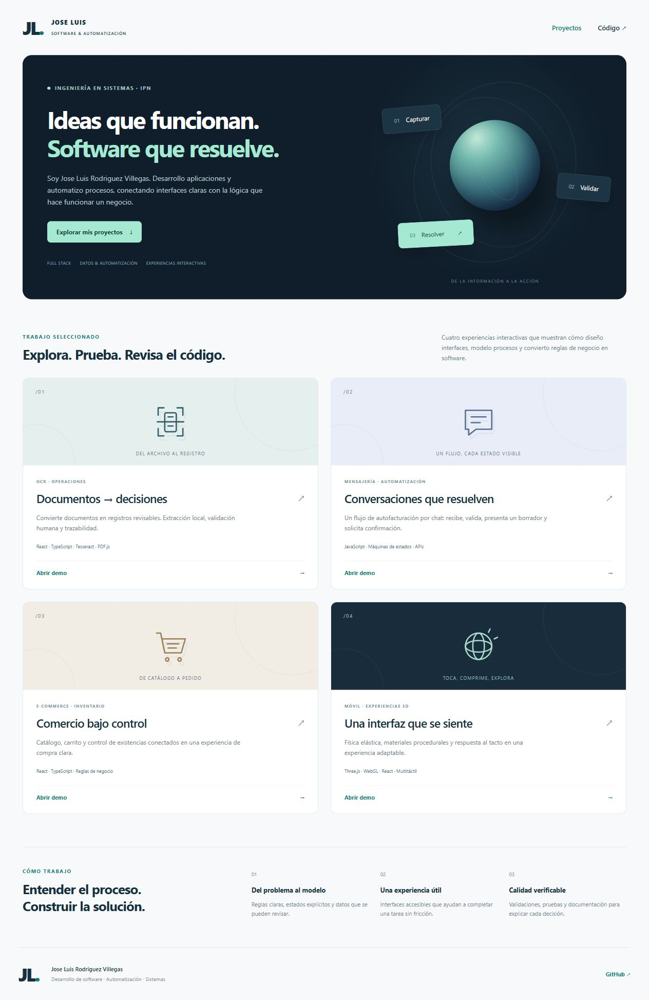

# Jose Luis · Software & automatización

**Un e-commerce en producción y demos interactivas de desarrollo Full Stack, automatización de procesos y experiencias 3D.**

[Abrir el portafolio](https://Jose-Vil.github.io/portfolio-software-demos/) · [Perfil de GitHub](https://github.com/Jose-Vil)



Soy Jose Luis Rodriguez Villegas, ingeniero en Sistemas Computacionales por el IPN. Este repositorio reúne versiones demostrativas de problemas que he abordado en mis proyectos: convertir documentos en información revisable, modelar procesos de atención por mensajería, administrar un flujo de compra e inventario y desarrollar interfaces interactivas.

## Prueba los proyectos

| Demo                                                                          | Recorrido                                                       | Qué muestra                                                                                                 |
| ----------------------------------------------------------------------------- | --------------------------------------------------------------- | ----------------------------------------------------------------------------------------------------------- |
| [Documentos](https://Jose-Vil.github.io/portfolio-software-demos/#documentos) | Carga el ejemplo, prueba OCR real, corrige y confirma campos    | Procesamiento local con Tesseract y PDF.js, revisión humana, validación, prevención de folios duplicados    |
| [Mensajería](https://Jose-Vil.github.io/portfolio-software-demos/#mensajeria) | HOLA → datos ficticios → LISTO → CONFIRMADO                     | Máquina de estados, deduplicación, aislamiento de conversaciones, resolución de evidencias contradictorias  |
| [Comercio](https://Jose-Vil.github.io/portfolio-software-demos/#comercio)     | Explora la tienda real de JRS Automation o el laboratorio local | E-commerce en producción con Next.js, Supabase y PostgreSQL; simulador independiente para probar inventario |
| [Interacción 3D](https://Jose-Vil.github.io/portfolio-software-demos/#movil)  | Elige la pelota interactiva o entra al universo                 | Física elástica; galaxia procedural, planetas, meteoros, navegación libre y doce coleccionables             |

## Alcance de esta edición pública

Los documentos, clientes e identificadores de las demos son ficticios. Los productos y precios del laboratorio de inventario también lo son. Estas demos usan memoria de la pestaña y se reinician al recargar. Los archivos seleccionados se procesan en el navegador; no se envían a un backend. Los recursos OCR se sirven desde el mismo origen del sitio. El portafolio no añade analítica.

La sección Comercio presenta el [sitio real de JRS Automation](https://www.jrsautomation.com.mx/) en un marco integrado y permite abrirlo directamente. Ese sitio opera con sus propios servicios, precios, disponibilidad y políticas. Su backend, configuraciones e historial privado no forman parte de este repositorio. El laboratorio de inventario continúa disponible como experiencia local independiente.

El universo reutiliza los módulos procedurales de mi proyecto original, con textos de exploración para esta edición pública. No incluye fotografías, recuerdos personales ni pistas de audio. Sus doce coleccionables y el estado de colección completada se guardan en localStorage, únicamente en el navegador. La escena se carga bajo demanda y libera sus recursos al salir; requiere WebGL. Ofrece controles táctiles y de teclado, regreso al centro y salida con Escape.

El chat simula el transporte que, en una integración real, recibiría eventos de mensajería o de un marketplace como Mercado Libre. No se conecta a Meta, Mercado Libre ni Facturama; no envía mensajes, genera CFDI o realiza cobros. La interfaz móvil es una demostración web adaptable; este repositorio no distribuye una aplicación Android ni solicita permisos del dispositivo.

Las demos locales muestran las reglas y la interacción. Las autorizaciones de usuarios, persistencia, concurrencia distribuida y transacciones de base de datos deben resolverse en un backend para uso productivo. El control de versiones del laboratorio de inventario ocurre en memoria. El OCR puede equivocarse: cada registro requiere revisión humana.

## Ejecutar localmente

Requisitos: Node.js 24 y pnpm 11.19.0.

```sh
pnpm install --frozen-lockfile
pnpm prepare:ocr
pnpm dev
```

Abre la URL que indique Vite, con la ruta `/portfolio-software-demos/`.

```sh
pnpm test
pnpm check:public
pnpm build
pnpm preview
```

Los modelos y motores OCR se generan en `public/ocr/` y no se incluyen en Git. La instalación respeta un listado explícito de scripts permitidos. El lockfile fija las dependencias.

## Estructura y decisiones

```text
src/demos/       Interfaces independientes, cargadas bajo demanda
src/core/        Reglas de negocio y lectura de documentos
src/components/ Física y renderizado 3D reutilizable
tests/          Casos de autorización, idempotencia, validación y concurrencia
scripts/        Preparación OCR y revisión del contenido público
docs/           Arquitectura, capturas y límites de la demo
```

Los motores de borradores/conversaciones y las escenas 3D se adaptaron de módulos reutilizables de mis proyectos. La interfaz del portafolio, la demo de documentos y el laboratorio de inventario se construyeron para esta edición pública. La tienda real se presenta desde su dominio existente. Se creó un historial nuevo y se excluyeron las configuraciones de producción, archivos operativos y recursos personales.

Consulta [la arquitectura](docs/ARCHITECTURE.md) y [la política de seguridad](SECURITY.md). El build verificado se publica en la rama `gh-pages` y GitHub Pages sirve esa edición estática. El código fuente está en `main`.

Se incluye un [ejemplo de GitHub Actions](docs/github-actions.example.yml) para automatizar verificaciones y despliegues en el futuro. Este ejemplo no se ejecuta mientras esté en `docs/`; su activación requiere configurar Pages para Actions y autorización para crear archivos de workflow. La publicación actual utiliza los permisos existentes de la cuenta.
