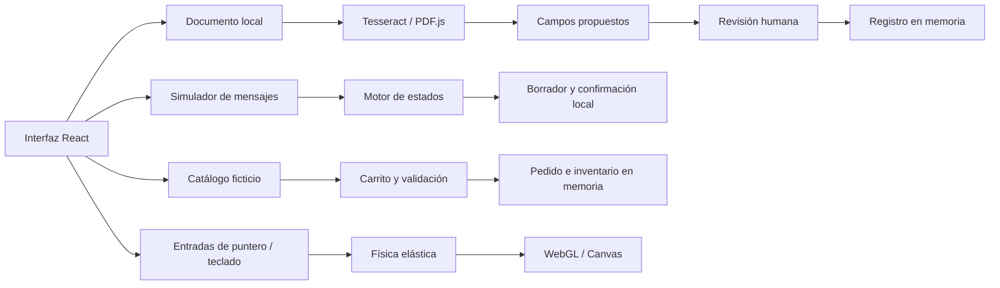

# Arquitectura

La aplicación es estática: React + TypeScript + Vite, sin backend, credenciales ni datos productivos.

## Documentos

Límites: 10 MB por archivo; PDF de hasta 8 páginas; imágenes PNG/JPG/WebP de hasta 24 megapíxeles. PDF.js extrae texto digital. Para un PDF escaneado se solicita exportar una página como imagen. La demo no ejecuta documentos ni interpreta sus instrucciones. Se conserva el texto como entrada; los campos propuestos se validan antes de agregarlos. Fechas imposibles, importes inválidos y folios repetidos se rechazan.

Tesseract descarga sus modelos desde el mismo sitio y reconoce dentro del navegador. El resultado y los archivos no se guardan en almacenamiento persistente de la aplicación.

## Mensajería

El adaptador simulado crea mensajes con IDs únicos. El motor comprueba remitente autorizado, propietario de sesión e IDs ya procesados. Solo un borrador válido permite confirmar; la confirmación produce un evento con clave de sesión y revisión. Reentregar el mismo mensaje no repite el evento.

Las evidencias de precio de marketplace se conservan como contexto. Los importes finales deben tener una fuente elegible. Si dos fuentes elegibles discrepan, el borrador solicita revisión. No se llama a ningún proveedor externo. En producción, un consumidor persistente del evento usaría esa clave para impedir emisiones repetidas.

## Comercio

La validación del carrito ocurre completa antes de calcular el nuevo estado del inventario. Cada cambio incrementa la versión. Un ajuste con una versión obsoleta se rechaza. El botón de cambio concurrente permite reproducir este escenario. En producción se requiere una operación atómica en la base de datos y autorización en servidor.

## 3D

Los contactos táctiles o de puntero alimentan un modelo elástico. Three.js renderiza materiales y texturas generados localmente. La escena limita la resolución de renderizado y limpia recursos al desmontarse. Si WebGL no está disponible, se ofrece un renderizador Canvas. El teclado permite probar la compresión sin usar el ratón.

## Despliegue

El build se verificó localmente y se publica como archivos estáticos en la rama `gh-pages`. GitHub Pages sirve esa rama sin conexiones a servicios operativos.

El ejemplo de workflow incluido en `docs/github-actions.example.yml` muestra cómo verificar tipos, reglas de negocio y contenido público, generar recursos OCR y publicar el sitio. No está activo. Si se habilita en el futuro, solo el trabajo de despliegue necesita permisos de escritura en Pages e identidad OIDC. No usa secretos de aplicaciones operativas.
